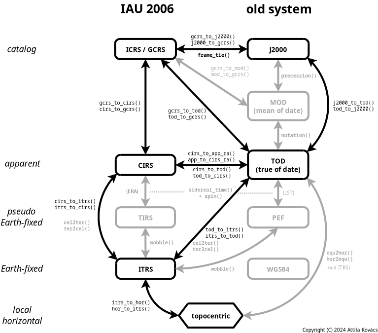
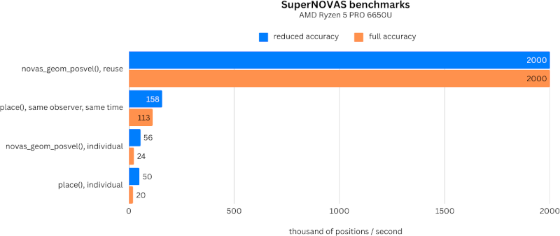

<a href="https://sigmyne.github.io/SuperNOVAS/doc/html/files.html">
 
</a>
<a href="https://codecov.io/gh/Sigmyne/SuperNOVAS">
 
</a>
<br clear="all">

<picture>
  <source srcset="resources/logo-light-300x113.png" alt="SuperNOVAS logo" media="(prefers-color-scheme: dark)"/>
  <source srcset="resources/logo-dark-300x113.png" alt="SuperNOVAS logo" media="(prefers-color-scheme: light)"/>
  
</picture>
<br clear="all">


# SuperNOVAS

<a href="https://doi.org/10.5281/zenodo.14584983">
 
</a>

The NOVAS C astrometry library, made better.

 - [C99 API documentation](https://sigmyne.github.io/SuperNOVAS/doc/html/topics.html)
 - [C++ API documentation](https://sigmyne.github.io/SuperNOVAS/doc/html/cpp/topics.html)
 - [SuperNOVAS pages](https://sigmyne.github.io/SuperNOVAS) on github.io 

[SuperNOVAS](https://github.com/Sigmyne/SuperNOVAS/) is a C/C++ astronomy software library, providing 
high-precision astrometry such as one might need for running an observatory, a precise planetarium program, or for
analyzing astronomical datasets. It started as a fork of the Naval Observatory Vector Astrometry Software 
([NOVAS](https://aa.usno.navy.mil/software/novas_info)) C version 3.1, but since then it has grown into its own, 
providing bug fixes, tons of new features, and a much improved API compared to the original NOVAS.

__SuperNOVAS__ is easy to use and it is very fast, with 3--5 orders of magnitude faster position calculations than 
[astropy](https://www.astropy.org/) 7.0.0 in a single thread (see the [benchmarks](#benchmarks)), and its performance 
will scale further with the number of CPUs when calculations are performed in parallel threads.

__SuperNOVAS__ is suitable for POSIX (e.g. Linux, BSD, MacOS, LynxOS), Windows, Android, as well as embedded and 
bare-metal platforms alike.

__SuperNOVAS__ is available through the [Sigmyne/SuperNOVAS](https://github.com/Sigmyne/SuperNOVAS) repository on 
GitHub, without licensing restrictions. Its source code is compatible with the C99 and C++11 standards, and hence 
should be suitable for old and new platforms alike. And, despite it being a light-weight library, it fully supports 
the [IAU 2000/2006 resolutions](https://www.iau.org/IAU/Iau/Publications/List-of-Resolutions.aspx) and the 
[IERS 2010 conventions](https://www.iers.org/IERS/EN/DataProducts/Conventions/conventions) for microarcsecond-level 
position calculations. 

This document has been updated for the `v1.8` and later releases.

### Citation

 - __Reference Paper__: Attila Kovács "The SuperNOVAS high-precision C/C++ astrometry library", __Proc. SPIE__, 
14155, _Software and Cyberinfrastructure for Astronomy IX_, 1415533 (2026); https://doi.org/10.1117/12.3104649<br>
[[BibTex]](resources/citation-14155_1079.bib) [[EndNote]](resources/citation-14155_1079.enw) [[RIS]](resources/citation-14155_1079.ris) 

## Table of Contents

 - [Introduction](#introduction)
 - [Fixed NOVAS C 3.1 issues](#fixed-issues)
 - [Compatibility with NOVAS C 3.1](#compatibility)
 - [Building and installation](#installation)
 - [Celestial coordinate systems (old vs. new)](#methodologies)
 - [Example use cases](#examples)
 - [Incorporating Solar-system ephemeris data or services](#solarsystem)
 - [Notes on precision](#precision)
 - [Runtime debug support](#debug-support)
 - [Representative benchmarks](#benchmarks)
 - [SuperNOVAS added features](#supernovas-features)
 - [Release schedule](#release-schedule)

-----------------------------------------------------------------------------

<a name="introduction"></a>
## Introduction

__SuperNOVAS__ is a supercharged fork of the The Naval Observatory Vector Astrometry Software 
([NOVAS](https://aa.usno.navy.mil/software/novas_info)). (It is not related to the separate NOVA / `libnova` library.)

The primary goal of __SuperNOVAS__ is to improve on the original NOVAS C library via:

 - Fixing [outstanding issues](#fixed-issues).
 - Adding a high-level [C++11 API](USAGE-CPP.md).
 - [New features](#added-functionality).
 - [Refined C99 API](#api-changes) to promote best programming practices.
 - Improved [C99 API documentation](https://sigmyne.github.io/SuperNOVAS/doc/html/files.html).
 - [Faster calculations](#benchmarks).
 - [Thread-safe calculations](https://github.com/Sigmyne/SuperNOVAS/blob/main/doc/USAGE-C99.md#multi-threading-c99).
 - [Debug mode](#debug-support) with informative error tracing.
 - [Regression testing](https://codecov.io/gh/Sigmyne/SuperNOVAS) and continuous integration on GitHub.

At the same time, __SuperNOVAS__ aims to be fully backward compatible with the intended functionality of the upstream 
NOVAS C library, such that it can be used as a _build-time_ replacement for NOVAS in your application without having 
to change existing (functional) code you may have written for NOVAS C. 

__SuperNOVAS__ is really quite easy to use. Its new API is just as simple and intuitive as that of __astropy__ (or so 
we strive for it to be), and it is similarly well documented also (see the 
documentation for the [C99](https://sigmyne.github.io/SuperNOVAS/doc/html/files.html) and/or
[C++](https://sigmyne.github.io/SuperNOVAS/doc/html/cpp/files.html) APIs). You can typically achieve the 
same results with similar lines of code on
[C](https://github.com/Sigmyne/SuperNOVAS/blob/main/doc/SuperNOVAS_vs_astropy.md) or 
[C++](https://github.com/Sigmyne/SuperNOVAS/blob/main/doc/cpp/SuperNOVAS++_vs_astropy.md)
with __SuperNOVAS__ as with __astropy__, notwithstanding a little more involved error handling (due to the lack of 
`try / except` style constructs in C/C++).
 
__SuperNOVAS__ was created and is maintained by [Attila Kovács](https://www.sigmyne.com/attipaci). Outside contributions 
are very welcome. See [how you can contribute](https://sigmyne.github.io/SuperNOVAS/doc/CONTRIBUTING.html) to make 
__SuperNOVAS__ even better.

### Related links

 - [NOVAS](https://aa.usno.navy.mil/software/novas_info) home page at the US Naval Observatory.
 - [CALCEPH C library](https://calceph.imcce.fr) for integrating Solar-system ephemerides
   from JPL and/or in INPOP 2.0/3.0 format.
 - [NAIF SPICE toolkit](https://naif.jpl.nasa.gov/naif/toolkit.html) for integrating Solar-system ephemerides
   from JPL.
 - [Sigmyne/cspice-sharedlib](https://github.com/Sigmyne/cspice-sharedlib) for building CSPICE as a shared
   library for dynamic linking.
 - [Standard SPICE kernels](https://naif.jpl.nasa.gov/naif/data.html) containing ephemeris data for planets and
   their moons, major steroids, comets, and space missions.
 - [JPL Horizons](https://ssd.jpl.nasa.gov/horizons/) system provides custom ephemeris data for all types of 
   Solar-system bodies as per request.
 - [IAU Minor Planet Center](https://www.minorplanetcenter.net/iau/mpc.html) provides up-to-date orbital elements
   for asteroids, comets, and near-Earth objects (NEOs), including newly discovered objects.
 - [Earth Rotation and Reference Systems Service (IERS)](https://www.iers.org/IERS/EN/DataProducts/EarthOrientationData/eop)
   provides Earth Orientation Parameter (EOP) data for many high accuracy calculations.


-----------------------------------------------------------------------------

<a name="fixed-issues"></a>
## Fixed NOVAS C 3.1 issues

__SuperNOVAS__ fixes a number of outstanding issues with NOVAS C 3.1:

<details>

 - Fixes the [sidereal_time bug](https://aa.usno.navy.mil/software/novas_faq), whereby the `sidereal_time()` function 
   had an incorrect unit cast. This was a documented issue of NOVAS C 3.1.
   
 - Fixes the [ephem_close bug](https://aa.usno.navy.mil/software/novas_faq), whereby `ephem_close()` in 
   `eph_manager.c` did not reset the `EPHFILE` pointer to NULL. This was a documented issue of NOVAS C 3.1.
     
 - Fixes antedating velocities and distances for light travel time in `ephemeris()`. When getting positions and 
   velocities for Solar-system sources, it is important to use the values from the time light originated from the 
   observed body rather than at the time that light arrives to the observer. This correction was done properly for 
   positions, but not for velocities or distances, resulting in incorrect observed radial velocities or apparent 
   distances being reported for spectroscopic observations or for angular-physical size conversions. 
   
 - Fixes bug in `ira_equinox()` which may return the result for the wrong type of equinox (mean vs. true) if the 
   `equinox` argument was changing from 1 to 0, and back to 1 again with the date being held the same. This affected 
   routines downstream also, such as `sidereal_time()`.
   
 - Fixes accuracy switching bug in `cio_basis()`, `cio_location()`, `ecl2equ()`, `equ2ecl_vec()`, `ecl2equ_vec()`, 
   `geo_posvel()`, `place()`, and `sidereal_time()`. All these functions returned a cached value for the other 
   accuracy if the other input parameters are the same as a prior call, except the accuracy. 
   
 - Fixes multiple bugs related to using cached values in `cio_basis()` with alternating CIO location reference 
   systems. This affected many CIRS-based position calculations downstream.
   
 - Fixes bug in `equ2ecl_vec()` and `ecl2equ_vec()` whereby a query with `coord_sys = 2` (GCRS) has overwritten the
   cached mean obliquity value for `coord_sys = 0` (mean equinox of date). As a result, a subsequent call with
   `coord_sys = 0` and the same date as before would return the results in GCRS coordinates instead of the requested 
   mean equinox of date coordinates.
 
 - Some remainder calculations in NOVAS C 3.1 used the result from `fmod()` unchecked, which resulted in angles outside
   of the expected [0:2&pi;] range and was also the reason why `cal_date()` did not work for negative JD values.
 
 - Fixes `aberration()` returning NaN vectors if the `ve` argument is 0. It now returns the unmodified input vector 
   appropriately instead.
   
 - Fixes unpopulated `az` output value in `equ2hor()` at zenith. While any azimuth is acceptable really, it results in 
   unpredictable behavior. Hence, we set `az` to 0.0 for zenith to be consistent.
   
 - Fixes potential string overflows and eliminates associated compiler warnings.
 
 - Nutation series used truncated expressions for the fundamental arguments, resulting in &mu;as-level errors in when 
   dozens or more years away from the reference epoch of J2000.
 
 - [__v1.1__] Fixes division by zero bug in `d_light()` if the first position argument is the ephemeris reference
   position (e.g. the Sun for `solsys3.c`). The bug affects for example `grav_def()`, where it effectively results in
   the gravitational deflection due to the Sun being skipped.
    
 - [__v1.1__] The NOVAS C 3.1 implementation of `rad_vel()` has a number of issues that produce inaccurate results. 
   The errors are typically at or below the tens of m/s level for objects not moving at relativistic speeds.
 
 - [__v1.4__] The NOVAS C 3.1 implementation of `cel2ter()` / `ter2cel()` was such that if both `xp` and `yp` 
   parameters were zero, then no wobble correction was applied, not even for the TIO longitude (s'). The error from 
   this omission is very small, at just a few &mu;as (microarcseconds) within a couple of centuries of J2000.
   
 - [__v1.6__] The NOVAS C `geo_posvel()` function is imprecise for geodetic observer locations on Earth, since it 
   does not account for polar offsets _x_<sub>p</sub>, _y_<sub>p</sub>. As such the geocentric GCRS observer position 
   and velocity vectors are accurate at the tens of meters level only. For Earth-based observers, __SuperNOVAS__ adds
   `novas_site_gcrs_posvel()` as a more precise alternative.
   
 - [__v1.8__] The NOVAS C `transform_cat()` calculated reprojected radial velocities using the Doppler factor derived
   for the original radial velocity, when applying proper motion. The resulting difference is typically negligible so
   long as the proper motion correction itself is small, but may become significant in case of large proper motion
   corrections.
   
 - [__v1.8__] The NOVAS C `transform_cat()` used the initial angular-to-physical conversion factor, based on the 
   initial distance, when calculating the final quantities. Instead, the conversion factor should be recalculated for 
   the final distance before calculating the output motion parameters.

</details>
   
-----------------------------------------------------------------------------

<a name="compatibility"></a>
## Compatibility with NOVAS C 3.1

__SuperNOVAS__ strives to maintain API compatibility with the upstream NOVAS C 3.1 library, but not binary (ABI) 
compatibility. 

If you have code that was written for NOVAS C 3.1, it should work with __SuperNOVAS__ as is, without modifications. 
Simply (re)build your application against __SuperNOVAS__, and you are good to go. 

The lack of binary compatibility just means that you cannot drop-in replace the libraries (e.g. the static 
`libnovas.a`, or the shared `libnovas.so`), from NOVAS C 3.1 with those from __SuperNOVAS__. Instead, you will have to 
build (compile) your application referencing the __SuperNOVAS__ headers and/or libraries from the start.

This is because some function signatures have changed, e.g. to use an `enum` argument instead of the nondescript 
`short int` option arguments used in NOVAS C 3.1, or because we added a return value to a function that was declared 
`void` in NOVAS C 3.1. We also changed the `object` structure to contain a `long` ID number instead of `short` to 
accommodate JPL NAIF codes, for which 16-bit storage is insufficient. 


-----------------------------------------------------------------------------

<a name="installation"></a>
## Building and installation

 - [Dependencies](#dependencies)
 - [Build / install using GNU make](#gnu-build)
 - [Build / install using CMake](#cmake-build)
 - [Install via `vcpkg`](#vcpkg-port)
 - [Linux packages](#linux-packages)
 - [Homebrew package](#homebrew)
 - [Nix package](#nix)


<a name="dependencies"></a>
### Dependencies

 - [`curl`](https://curl.se/) -- (recommended) for fetching Earth Orientation data from IERS or from elsewhere.
 - [`calceph`](https://calceph.imcce.fr/docs/latest/html/c/) -- (recommended) for using CALCEPH as the Solar-system 
   ephemeris provider.
 - [`cspice`](https://naif.jpl.nasa.gov/naif/toolkit.html) -- (optional) for usign the NAIF CSPICE Toolkit as the Solar-system 
   ephemeris provider.
 - [`doxygen`](https://www.doxygen.nl/) -- (optional) for compiling HTML documentation.
 
#### Installing dependencies on Linux

<details>
On Fedora / EPEL Linux and derivatives, you may install all packaged (build + runtime) dependencies as:

```bash
  sudo dnf install libcurl-devel calceph-devel doxygen
```

And on Debian and derivatives (e.g. Ubuntu, Mint, Alpine), you may do the same with:

```bash
  sudo apt-get install libcurl4-openssl-dev calceph-dev doxygen
```
</details>

#### Installing dependencies on MacOS

<details>
On MacOS you may install the dependencies with Homebrew:

```bash
  brew install curl calceph doxygen
```
</details>

#### Installing dependencies on BSD

<details>
On BSD (e.g. FreeBSD, OpenBSD) you might install `curl` and `calceph`. And you will also need additional packages for 
building __SuperNOVAS__, such as and `cmake` and/or `gmake`, and `pkgconf`:

```bash
  pkg install -y gmake cmake devel/pkgconf curl calceph 
```
</details>

<a name="gnu-build"></a>
### Build / install using GNU make

The __SuperNOVAS__ distribution contains a GNU `Makefile`, which is suitable for compiling the library (as well as 
local documentation, and tests, etc.) on POSIX systems such as Linux, MacOS X, BSD, Cygwin or WSL -- using 
[GNU `make`](https://www.gnu.org/software/make/).

<details>

Before compiling the library take a look a `config.mk` and edit it as necessary for your needs, or else define
the necessary variables in the shell prior to invoking `make`. For example:
   
 - `ENABLE_CPP`: As of v1.6, __SuperNOVAS__ offers a C++11 API and library also, but it is not enabled by default. To
   build C++ library (`libsupernovas++`), and install the C++ header (`supernovas.h`) and documentation you should
   set this option to 1, either in your environment or else in `config.mk`. 
 
 - [CALCEPH](https://www.imcce.fr/recherche/equipes/asd/calceph/) C library integration is automatic on Linux if 
   `ldconfig` can locate the `libcalceph` shared library. You can also control CALCEPH integration manually, e.g. by 
   setting `CALCEPH_SUPPORT = 1` in `config.mk` or in the shell prior to the build. CALCEPH integration will require 
   an accessible installation of the CALCEPH development files (C headers and unversioned static or shared libraries 
   depending on the needs of the build).
   
 - [NAIF CSPICE Toolkit](https://naif.jpl.nasa.gov/naif/toolkit.html) integration is automatic on Linux if `ldconfig` 
   can locate the `libcspice` shared library. You can also control CSPICE integration manually, e.g. by setting 
   `CSPICE_SUPPORT = 1` in `config.mk` or in the shell prior to the build. CSPICE integration will require an 
   accessible installation of the CSPICE development files (C headers, under a `cspice/` subfolder in the header 
   search path, and unversioned static or shared libraries depending on the needs of the build). You might want to 
   check out the [Sigmyne/cspice-sharedlib](https://github.com/Sigmyne/cspice-sharedlib) repository for 
   building CSPICE as a shared library.
   
 - If your compiler does not support the C11 standard and it is not GCC &gt;=3.3, but provides some nonstandard
   support for declaring thread-local variables, you may want to pass the keyword to use to declare variables as
   thread local via `-DTHREAD_LOCAL=...` added to `CFLAGS`. (Don't forget to enclose the string value in escaped
   quotes in `config.mk`, or unescaped if defining the `THREAD_LOCAL` shell variable prior to invoking `make`.)

Additionally, you may set number of environment variables to futher customize the build, such as:

 - `CC`: The C compiler to use (default: `gcc`).

 - `CPPFLAGS`: C preprocessor flags, such as externally defined compiler constants.
 
 - `CFLAGS`: Flags to pass onto the C compiler (default: `-g -Os -Wall`). Note, `-Iinclude` will be added 
   automatically.
   
 - `LDFLAGS`: Extra linker flags (default is _not set_). Note, `-lm` will be added automatically.
   
 - `CSTANDARD`: Optionally, specify the C standard to compile for, e.g. `c99` to compile for the C99 standard. If
   defined then `-std=$(CSTANDARD)` is added to `CFLAGS` automatically.
   
 - `WEXTRA`: If set to 1, `-Wextra` is added to `CFLAGS` automatically.
   
 - `FORTIFY`: If set it will set the `_FORTIFY_SOURCE` macro to the specified value (`gcc` supports values 1 
   through 3). It affords varying levels of extra compile time / runtime checks.

 - `CHECKEXTRA`: Extra options to pass to `cppcheck` for the `make check` target
 
 - `WITHOUT_CURL`: Setting to 1 disables building against `libcurl`. Without cURL support, the EOP fetching functions 
   and methods will return an error or invalid EOP, with `errno` set to `ENOSYS`.

 - `WITHOUT_LIBC`: Setting to 1 builds the library for bare-metal or WebAssembly targets that have no libc file I/O, 
   heap allocator, or system clock. This sets the `WITHOUT_LIBC`, `WITHOUT_SYSTEM_CLOCK`, and `WITHOUT_CURL` 
   preprocessor flags. Without `libc` support, you cannot use the system clock to set current time, and/or manage
   leap seconds and Earth Orientation Parameters automatically. You must set these explicitly instead. See 
   [Cross-compiling for embedded targets](#cross-compile) section below.
 
 - `DOXYGEN`: Specify the `doxygen` executable to use for generating documentation. If not set (default), `make` will
   use `doxygen` in your `PATH` (if any). You can also set it to `none` to disable document generation and the
   checking for a usable `doxygen` version entirely.

Now you are ready to build the library:

```bash
  $ make
```

will compile the shared (e.g. `lib/libsupernovas.so`) libraries, and compile the API documentation (into `doc/`) 
using `doxygen` (if available). Alternatively, you can build select components of the above with the `make` targets 
`shared`, and `local-dox` respectively. And, if unsure, you can always call `make help` to see what build targets are 
available.

To build __SuperNOVAS__ as static libraries, use `make static`.

After building the library you can install the above components to the desired locations on your system. For a 
system-wide install you may simply run:

```bash
  $ sudo make install
```

Or, to install in some other locations, you may set a prefix and/or `DESTDIR`. For example, to install under `/opt` 
instead, you can:

```bash
  $ sudo make prefix="/opt" install
```

Or, to stage the installation (to `/usr`) under a 'build root':

```bash
  $ make DESTDIR="/tmp/stage" install
```

</details>

> [!NOTE]
> if you want to build __SuperNOVAS__ for your old NOVAS C application you might want to further customize the build. 
> See section on 
> [legacy application](https://github.com/Sigmyne/SuperNOVAS/blob/main/doc/USAGE-C99.md#legacy-application-c99) in the 
> [C99 User's guide](USAGE-C99.md). 


#### Building with GNU make on BSD

<details>

On BSD, you will need to use `gmake` instead of `make` (see section on dependencies above). You will also need 
`pkgconf` s.t. `gcc` may locate the dependencies (headers and libraries). In practice, it means setting 
`CPPFLAGS` and `LDFLAGS` to contain the appropriate include and library paths and libraries prior to calling
`gmake`. E.g., to build against both `libcurl` and `calceph`: 

```bash
  export CPPFLAGS=`pkg-config --cflags libcurl calceph`
  export LDFLAGS=`pkg-config --libs libcurl calceph`
```

Now you can build __SuperNOVAS__, for example as a shared library, with:

```bash
  gmake shared
```

</details>


<a name="cross-compile"></a>
#### Cross-compiling for embedded targets

__SuperNOVAS__ can be compiled as a static library for bare-metal embedded systems (e.g. ARM Cortex-M) or WebAssembly
targets (as of v1.7, thanks to Kiran Shila). Set `WITHOUT_LIBC=1` to build in freestanding mode, which disables all 
`libc` file I/O, heap allocation, and system clock dependencies:

<details>
For embedded ARM, this may look like:

```bash
  make CC=arm-none-eabi-gcc WITHOUT_LIBC=1 \
       CFLAGS="-mcpu=cortex-m33 -mthumb -mfloat-abi=hard -mfpu=fpv5-sp-d16 -Os -Wall" \
       static
```

where we cross-compile using the `arm-none-eabi-gcc` compiler with target-specific flags.

For WebAssembly with [Emscripten](https://emscripten.org/), use `emmake` which substitutes the compiler and archiver
automatically:

```bash
  emmake make WITHOUT_LIBC=1 static
```

Note, that some __SuperNOVAS__ functionality is lost when built without `libc`, such as setting current time or 
managing leap seconds and EOP automatically. Thus, you will have to specify these explicity instead, when needed.

</details>


<a name="cmake-build"></a>
### Build / install using CMake 

As of v1.5, __SuperNOVAS__ can be built using [CMake](https://cmake.org/) (big thanks to Kiran Shila). CMake allows 
for greater portability than the regular GNU `Makefile`. Note, however, that the CMake configuration does not support 
all of the build options of the GNU `Makefile`, such as automatic CALCEPH and CSPICE integration on Linux, supporting 
legacy NOVAS C style builds, and code coverage tracking. 

<details>

The basic build recipe for CMake is:

```bash
  $ cmake -B build
  $ cmake --build build
```

The __SuperNOVAS__ CMake build supports the following options (in addition to the standard CMake options):

 - `BUILD_SHARED_LIBS=ON|OFF` (default: OFF) - Build shared libraries instead of static
 - `BUILD_DOC=ON|OFF` (default: OFF) - Compile HTML documentation. Requires `doxygen`.
 - `BUILD_EXAMPLES=ON|OFF` (default: OFF) - Build the included examples
 - `BUILD_TESTING=ON|OFF` (default: ON) - Build regression tests
 - `BUILD_BENCHMARK=ON|OFF` (default: OFF) - Build benchmarking programs 
 - `WITHOUT_CURL=ON|OFF` (default: OFF) - Build without [cURL](https://curl.se/) support (fetching EOP from IERS will 
   not be possible without cURL support).
 - `WITHOUT_LIBC=ON|OFF` (default: OFF) - Build for bare-metal or WebAssembly targets that have no libc file I/O, heap 
   allocator, or system clock.
 - `ENABLE_CPP=ON|OFF` (default: OFF) - Build C++11 library (`supernovas++`) also. 
 - `ENABLE_CALCEPH=ON|OFF` (default: OFF) - Optional CALCEPH ephemeris plugin support. Requires `calceph` package.
 - `ENABLE_CSPICE=ON|OFF` (default: OFF) - Optional CSPICE ephemeris plugin support. Requires `cspice` library 
   installed.

For example, to configure the build of __SuperNOVAS__ with shared libraries and with 
[CALCEPH](https://calceph.imcce.fr) integration for ephemeris support:

```bash
  $ cmake -B build -DBUILD_SHARED_LIBS=ON -DENABLE_CALCEPH=ON
```

and then perform the build:

```bash 
  $ cmake --build build
```

Or, on Windows (Microsoft Visual C) you will want:

```bash
  $ cmake --build build --config Release
```

If the config / `CMAKE_BUILD_TYPE` is not set, the build will only use the `CFLAGS` (if any) that were set in the 
environment. This is ideal for those who want to have full control of the compiler flags used in the build. 
Specifying `Release` or `Debug` will append a particular set of appropriate compiler options which are suited for the 
given build type. (If you want to use the MinGW compiler on Windows, you'll want to set 
`-DCMAKE_C_COMPILER=gcc -G "MinGW Makefiles"` options also.)

After a successful build, you can install the `Runtime` (libraries), and `Development` (headers, CMake config, and 
`pkg-config`) components, e.g. under `/usr/local`, as:

```bash
  $ cmake --install build --prefix /usr/local 
```

Or, you can use the `--component` option to install just the selected components. For example to install just
the `Runtime` component:

```bash
  $ cmake --install build --component Runtime --prefix /usr/local
```
</details>


<a name="vcpkg-port"></a>
### Install via `vcpkg`

As of version 1.5, __SuperNOVAS__ is available through the [vcpkg](https://vcpkg.io/en/) registry. The `vcpkg` port 
supports a wide range of platforms, including Linux, Windows, MacOS, and Android -- for both `arm64` and `x64` 
architectures (and in case of Windows also `x86`). It is effectively the same as the CMake build (above), only with 
more simplicity, convenience, and dependency resolution.

<details>

The `vcpkg` port has optional add-on features, which may be installed along with the `core` library as needed. The 
following features are available:

 - `core` -- The core C99 library (this is installed by default if no components are specified).
 - `cpp` -- The C++11 extension runtime and development files.
 - `solsys-calceph` -- CALCEPH plugin runtime and development files. (It also installs the `calceph` dependency as 
   needed).

You can install just the core C99 library of SuperNOVAS (without the C++ API and CALCEPH support) with `vcpkg` as:

```bash
  $ vcpkg install supernovas
```

Or, with a selected set of features, such as:

```bash
  $ vcpkg install supernovas[core,cpp,solsys-calceph]
```

</details>


<a name="linux-packages"></a>
### Linux packages

__SuperNOVAS__ is packaged for Fedora / EPEL and Debian Linux distributions, and derivatives based on these 
(Ubuntu, Mint, RHEL, CentOS Stream, Alma Linux, Rocky Linux, Oracle Linux etc.).

<details>

On Fedora / EPEL based distributions you might install all components via:

```bash
  $ sudo dnf install supernovas supernovas-c++ supernovas-solsys-calceph supernovas-doc supernovas-devel
```

And, on Debian-based platforms (such as Ubuntu or Mint) as:

```bash
  $ sudo apt-get install libsupernovas1 libsupernovas++1 libsolsys-calceph1 libsupernovas-doc libsupernovas++-doc libsupernovas-dev
```


In both cases the first package is the runtime library, the second is the C++11 runtime library, the third is the 
runtime for the `solsys-calceph` plugin, then documentation, and finally the files needed for application development.

</details>

> [!NOTE] 
> The turnaround time for Debian packages is quite slow, and typically follows the Debian release cycle, whereas the 
> Fedora / EPEL packages are usually fully up-to-date (i.e. in `stable`) within a week of a new SuperNOVAS release. 
> Somewhat newer Debian versions may be found in `testing`, but even that tends to lag behind the `stable` Fedora / 
> EPEL updates.


<a name="homebrew"></a>
### Homebrew package

As of version 1.5, there is also a [Homebrew](https://brew.sh/) package through the maintainer's own Tap.

<details>

To install SuperNOVAS via Homebrew, in the recommended default configuration:

```bash
  $ brew tap attipaci/pub
  $ brew install supernovas
```

The above will build and install SuperNOVAS with the C++ API extension and the CALCEPH plugin support (including the 
`calceph` dependency, as needed). However, you may add further options to customize your build:

 - `--with-doxygen` -- Install with local HTML documentation.
 - `--without-c++` -- Install without the C++ API extension and runtime.
 - `--without-calceph` -- Install without CALCEPH support (and dependency).
 - `--without-curl` -- Install without `libcurl` support (disables EOP fetching from IERS).

</details>

<a name="nix"></a>
### Nix package

As of version 1.5, there is also a [Nix](https://nixos.org/) [package](https://search.nixos.org/packages?channel=unstable&show=supernovas&query=supernovas).
This declarative and determinstic package manager can be used on every Linux distribution as well as MacOS.
The default package includes the `solsys-calceph` plugin, but can be overriden by changing `withCalceph`.

<details>

Install to your profile with

```bash
  $ nix profile add nixpkgs#supernovas
```

Or include in your Nix build of other software with

```nix
  nativeBuildInputs = with pkgs; [supernovas];
```

</details>


-----------------------------------------------------------------------------


<a name="methodologies"></a>
## Celestial coordinate systems (old vs. new)

|  |
|:--:| 
| __Figure 1.__ SuperNOVAS Coordinate Systems and Conversions. Functions indicated in bold face are available in NOVAS C also. All other functions are available in SuperNOVAS only. SuperNOVAS also adds efficient [matrix transformations](https://github.com/Sigmyne/SuperNOVAS/blob/main/doc/USAGE-C99.md#transforms-c99) between the equatorial systems. |


The [IAU 2000 and 2006 resolutions](https://www.iau.org/IAU/Iau/Publications/List-of-Resolutions.aspx) have completely 
overhauled the system of astronomical coordinate transformations to enable higher precision astrometry. (Super)NOVAS 
supports coordinate calculations both in the old (pre IAU 2000) ways, and in the new IAU standard method. The table 
below provides an overview of how the old and new methods define some of the terms differently:


 | Concept                    | Old standard                  | New IAU standard                                  |
 |:-------------------------- | ----------------------------- | ------------------------------------------------- |
 | Catalog coordinate system  | MOD (e.g. FK4, FK5, HIP...)   | International Celestial Reference System (ICRS)   |
 | Dynamical system           | True of Date (TOD)            | Celestial Intermediate Reference System (CIRS)    |
 | Dynamical R.A. origin      | equinox of date               | Celestial Intermediate Origin (CIO)               |
 | Precession, nutation, bias | no tidal terms                | IAU 2000/2006 precession/nutation model           |
 | Celestial Pole offsets     | d&psi;, d&epsilon; (for TOD)  | _x_<sub>p</sub>, _y_<sub>p</sub> (for ITRS)       |
 | Earth rotation measure     | Greenwich Sidereal Time (GST) | Earth Rotation Angle (ERA)                        |
 | Pseudo Earth-fixed system  | PEF                           | Terrestrial Intermediate Reference System (TIRS)  |
 | Earth rotation origin      | Greenwich Meridian            | Terrestrial Intermediate Origin (TIO)             |
 | Earth-fixed System         | WGS84                         | International Terrestrial Reference System (ITRS) |
 
 
See the various enums and constants defined in `novas.h`, as well as the descriptions on the various NOVAS routines
on how they are appropriate for the old and new methodologies respectively. Figure 1 also shows the relation of the
various old and new coordinate systems and the (Super)NOVAS functions for converting position / velocity vectors among 
them.

> [!NOTE]
> In NOVAS, the barycentric BCRS and the geocentric GCRS systems are effectively synonymous to ICRS, since the origin 
> for positions and for velocities, in any reference system, is determined by the `observer` location. Aberration and 
> gravitational deflection correction included for apparent places only (as seen from the observer location, 
> regardless of where that is), but not for geometric places. 

> [!TIP]
> Older catalogs, such as J2000 (FK5), HIP, B1950 (FK4) or B1900 are just special cases of MOD (mean-of-date) 
> coordinates for the J2000, J1991.25, B1950, and B1900 epochs, respectively.

> [!CAUTION] 
> Applying residual polar offsets (&Delta;d&psi;, &Delta;d&epsilon; or _x_<sub>p</sub>, _y_<sub>p</sub>) to the 
> TOD equator (via `cel_pole()`) is discouraged. Instead, the sub-arcsecond level corrections to Earth orientation 
> (_x_<sub>p</sub>, _y_<sub>p</sub>) should be used only for converting between the pseudo Earth-fixed (PEF or TIRS) 
> and ITRS, and vice-versa (e.g. with `novas_make_frame()` or `wobble()`).

> [!NOTE]
> WGS84 has been superseded by ITRS for higher accuracy definitions of Earth-based locations. WGS84 matches ITRS to 
> the 10m level globally, but it does not account for continental drifts and crustal motion. In (Super)NOVAS all 
> Earth-base locations are presumed ITRS. ITRS longitude, latitude, and altitude coordinates are referenced to the 
> GRS80 ellipsoid, whereas GPS locations are referenced to the WGS84 ellipsoid. __SuperNOVAS__ offers ways to convert 
> between the two if needed.


-----------------------------------------------------------------------------

<a name="examples"></a>
## Example use cases

 - [Recommendation: set up an ephemeris provider](#recommendation)
 - [Pick you flavor (C or C++)](#usage-flavors)

<a name="recommendation"></a>
### Recommendation: set up an ephemeris provider

__SuperNOVAS__ can do a lot of things on its own. What it cannot do alone is provide precise positions for 
Solar-system bodies. For that, you need ephemeris data and a helping hand from an external tool to access them. Even 
if you don't particularly care to obtain precise planet positions per se, they are needed for a range of 
high-precision calculations (such as for positional calculations for Earth-based observers, and gravitational 
deflections in full-precision observing frames).

Therefore, it is strongly recommended that you download 
[planetary ephemeris files from NASA / JPL](https://naif.jpl.nasa.gov/pub/naif/generic_kernels/spk/planets/) (such as 
the DE440, or the smaller DE440s, or the long-term DE441), and install [CALCEPH](https://calceph.imcce.fr/) or the 
[CSPICE Toolkit](https://naif.jpl.nasa.gov/naif/toolkit.html) for accessing these. I recommend CALCEPH, because it is 
more widely available (also in packaged form), and it is also more modern, and actively maintained. 

Provided you installed CALCEPH, your use of __SuperNOVAS__ should always start with something like this (regardless 
of whether you will use the C99 or the C++ API afterwards):

```c
 #include <novas-calceph.h>
  
 // Use DE440, DE440s, or DE441 as your planet provider...
 t_calcephbin *pleph = calceph_open("/path/to/de440.bsp");
 status = novas_use_calceph_planets(pleph);
 if(status < 0) {
   // Oops something went wrong...
 }
```

Don't forget to link with `-lsolsys-calceph` and `-lcalceph` flags added you yor build. With that, you have now 
unlocked a lot of the high-precision capabilities of __SuperNOVAS__. Have fun with it!

For more details on using CALCEPH or integrating other ways for providing ephemeris data to __SuperNOVAS__ look at 
the [section below](#solarsystem).


<a name="usage-flavors"></a>
### Pick your flavor (C or C++)

As of v1.6 __SuperNOVAS__ comes in two flavors, the original C99 API, and a higher-level C++11 API. Depending on which 
one you intend to use, choose the appropriate link to an external document below for further information:

 - [Using the C99 API](USAGE-C99.md)
 - [Using the C++11 API](USAGE-CPP.md)


-----------------------------------------------------------------------------

<a name="solarsystem"></a>
## Incorporating Solar-system ephemeris data or services

If you want to use __SuperNOVAS__ to calculate positions for a range of Solar-system objects, and/or to do it with 
precision, you will have to interface it to a suitable provider of ephemeris data. The preferred ways to do that in
__SuperNOVAS__ enumerated below. (The legacy NOVAS C ways are not covered here, since they require specialized builds 
of __SuperNOVAS__, which are covered 
[separately](https://github.com/Sigmyne/SuperNOVAS/blob/main/doc/USAGE-C99.md#legacy-application).)

NASA/JPL provides [generic ephemerides](https://naif.jpl.nasa.gov/pub/naif/generic_kernels/spk/) for the major 
planets, satellites thereof, the 300 largest asteroids, the Lagrange points, and some Earth orbiting stations. For 
example, [DE440](https://naif.jpl.nasa.gov/pub/naif/generic_kernels/spk/planets/de440.bsp) covers the major planets, 
and the Sun, Moon, and barycenters for times between 1550 AD and 2650 AD. Or, you can use the 
[JPL HORIZONS](https://ssd.jpl.nasa.gov/horizons/) system (via the command-line / telnet or API interfaces) to 
generate custom ephemerides (SPK/BSP) for just about all known solar systems bodies, down to the tiniest rocks.

 - [CALCEPH integration](#calceph-integration)
 - [NAIF CSPICE toolkit integration](#cspice-integration)
 - [Universal ephemeris data / service integration](#universal-ephemerides)

<a name="calceph-integration"></a>
### CALCEPH integration

The [CALCEPH](https://www.imcce.fr/recherche/equipes/asd/calceph/) library provides easy-to-use access to JPL and 
INPOP ephemeris files from C/C++. As of version 1.2, we provide optional support for interfacing __SuperNOVAS__ with 
the CALCEPH C library for handling Solar-system objects.

<details>

Prior to building __SuperNOVAS__ simply set `CALCEPH_SUPPORT` to 1 in `config.mk` or in your environment (or for CMake
configure with the `-DENABLE_CALCEPH=ON`). Depending on the build target (or type), it will build 
`libsolsys-calceph.so[.1]` (target `shared` or CMake option `-DBUILD_SHARED_LIBS=ON1`) or `libsolsys-calceph.a` (target 
`static` or default CMake build) libraries or `solsys-calceph.o` (target `solsys`, no CMake equivalent), which provide 
the `novas_use_calceph()` and  `novas_use_calceph_planets()`, and `novas_calceph_use_ids()` functions.

Of course, you will need access to the CALCEPH C development files (C headers and unversioned `libcalceph.so` or `.a` 
library) for the build to succeed. Here is an example on how you'd use CALCEPH with __SuperNOVAS__ in your application 
code:

First and foremost, you should use CALCEPH to provide planet positions via the DE440 or DE440s (smaller file size) 
or DE441 (long term) ephemeris data:

```c
 #include <novas-calceph.h>
  
 // Use DE440, DE440s, or DE441 as your planet provider...
 t_calcephbin *pleph = calceph_open("/path/to/de440.bsp");
 status = novas_use_calceph_planets(pleph);
 if(status < 0) {
   // Oops something went wrong...
 }
```

Even if you don't care for the planets, you'll still need the planetary ephemeris for a lot of the high-precision
calculations, so don't skip on this step if you can help it.

Beyond just the planets, you might want to download and use further ephemeris data, such as for the many moons 
orbiting planets, the major asteroids, various minor bodies of interest (e.g. comets, NEOs), or man-made spacecrafts. 
You can activate an additional set (or sets) of ephemeris files separately from the planetary ephemeris above. For 
example:

```c
 // Open all files that you will use concurrently
 t_calcephbin *eph = calceph_open_array(...);
  
 // Tell SperNOVAS to use CALCEPH with these files for obtaining
 // positions for objects contained within them
 int status = novas_use_calceph(eph);
 if(status < 0) {
   // Oops something went wrong...
 }
```

All modern JPL (SPK) ephemeris files should work with the `solsys-calceph` plugin. When linking your application, 
add `-lsolsys-calceph` to your link flags (or else link with `solsys-calceph.o`), and link against the CALCEPH library 
also (`-lcalceph`). That's all there is to it.

When using CALCEPH, ephemeris objects are referenced by their ID numbers (`object.number`), unless it is set to -1, in 
which case name-based lookup will be used instead. ID numbers are assumed to be NAIF by default, but 
`novas_calceph_use_ids()` can select between NAIF or CALCEPH numbering systems, if necessary.

</details>

<a name="cspice-integration"></a>
### NAIF CSPICE toolkit integration

The [NAIF CSPICE Toolkit](https://naif.jpl.nasa.gov/naif/toolkit.html) is the canonical standard library for JPL 
ephemeris files from C/C++. As of version 1.2, we provide optional support for interfacing __SuperNOVAS__ with CSPICE 
for handling Solar-system objects.

<details>

Prior to building __SuperNOVAS__ simply set `CSPICE_SUPPORT` to 1 in `config.mk` or in your environment (or for CMake
configure with `-DENABLE_CSPICE=ON`). Depending on the build target, it will build `libsolsys-cspice.so[.1]` (target 
`shared` or CMake option `-DBUILD_SHARED_LIBS=ON`) or `libsolsys-cspice.a` (target `static` or default CMake build) 
libraries or `solsys-cspice.o` (target `solsys`, no CMake equivalent), which provide the `novas_use_cspice()`, 
`novas_use_cspice_planets()`, and `novas_use_cspice_ephem()` functions to enable CSPICE for providing data for all 
Solar-system sources, or for major planets only, or for other bodies only, respectively. You can also manage the 
active kernels with the `cspice_add_kernel()` and `cspice_remove_kernel()` functions.

Of course, you will need access to the CSPICE development files (C headers, installed under a `cspice/` directory 
of a header search location, and the unversioned `libcspice.so` or `.a` library) for the build to succeed. You may 
want to check out the [Sigmyne/cspice-sharedlib](https://github.com/Sigmyne/cspice-sharedlib) GitHub 
repository to help you build CSPICE with shared libraries and dynamically linked tools.

Here is an example on how you might use CSPICE with __SuperNOVAS__ in your application code:

```c
 #include <novas-cspice.h>

 // You can load the desired kernels for CSPICE
 // E.g. load DE440s and the Mars satellites:
 int status;
  
 status = cspice_add_kernel("/path/to/de440s.bsp");
 if(status < 0) {
   // oops, the kernels must not have loaded...
   ...
 }
  
 // Load additional kernels as needed...
 status = cspice_add_kernel("/path/to/mar097.bsp");
 ...
  
 // Then use CSPICE as your SuperNOVAS ephemeris provider
 novas_use_cspice();
```

All JPL ephemeris data will work with the `solsys-cspice` plugin. When linking your application, add `-lsolsys-cspice` 
to your link flags (or else link with `solsys-cspice.o`), and of course the CSPICE library also. That's all there is 
to it.

When using CSPICE, ephemeris objects are referenced by their NAIF ID numbers (`object.number`), unless that number is 
set to -1, in which case name-based lookup will be used instead.

</details>


<a name="universal-ephemerides"></a>
### Universal ephemeris data / service integration 

Possibly the most universal way to integrate ephemeris data with __SuperNOVAS__ is to write your own 
`novas_ephem_provider` function.

<details>

```c
 int my_ephem_reader(const char *name, long id, double jd_tdb_high, double jd_tdb_low, 
                     enum novas_origin *restrict origin, 
                     double *restric pos, double *restrict vel) {
   // Your custom ephemeris reader implementation here
   ...
 }
```

which takes an object ID number (such as a NAIF), an object name, and a split TDB date (for precision) as it inputs, 
and returns the type of origin with corresponding ICRS position and velocity vectors in the supplied pointer 
locations. The function can use either the ID number or the name to identify the object or file (whatever is the most 
appropriate for the implementation and for the supplied parameters). The positions and velocities may be returned 
either relative to the SSB or relative to the  heliocenter, and accordingly, your function should set the value 
pointed at by origin to `NOVAS_BARYCENTER` or `NOVAS_HELIOCENTER` accordingly. Positions and velocities are 
rectangular ICRS _x,y,z_ vectors in units of AU and AU/day respectively. 

This way you can easily integrate current ephemeris data, e.g. for the Minor Planet Center (MPC), or whatever other 
ephemeris service you prefer.

Once you have your adapter function, you can set it as your ephemeris service via `set_ephem_provider()`:

```c
 set_ephem_provider(my_ephem_reader);
```

By default, your custom `my_ephem_reader` function will be used for `NOVAS_EPHEM_OBJECT` type objects only (i.e. 
anything other than the major planets, the Sun, Moon, Solar-system Barycenter...). But, you can use the same function 
for the major planets (`NOVAS_PLANET` type objects) also via:

```c
 set_planet_provider(planet_ephem_provider);
 set_planet_provider_hp(planet_ephem_provider_hp);
```

The above simply instructs __SuperNOVAS__ to use the same ephemeris provider function for planets as what was set
for `NOVAS_EPHEM_OBJECT` type objects, provided you compiled __SuperNOVAS__ with `BUILTIN_SOLSYS_EPHEM = 1` (in 
`config.mk`), or else you link your code against `solsys-ephem.c` explicitly. Easy-peasy.

</details>


<a name="precision"></a>
## Notes on precision

 - [Prerequisites to precise results](#accuracy-prerequisites)
 - [Reduced accuracy shortcuts](#reduced-accuracy)

Many of the (Super)NOVAS functions take an accuracy argument, which determines to what level of precision quantities 
are calculated. The argument can have one of two values, which correspond to typical precisions around:

 | `enum novas_accuracy` value  | Typical precision                |
 | ---------------------------- |:-------------------------------- |
 | `NOVAS_REDUCED_ACCURACY`     | ~ 1 milli-arcsecond (mas)        |
 | `NOVAS_FULL_ACCURACY`        | ~ 1 micro-arcsecond (&mu;as)     |

Note, that some functions will not support full accuracy calculations, unless you have provided a high-precision
ephemeris provider for the major planets (and any Solar-system bodies of interest), which does not come with 
__SuperNOVAS__ out of the box. In the absence of a suitable high-precision ephemeris provider, some functions might 
return an error if called with `NOVAS_FULL_ACCURACY`.


<a name="accuracy-prerequisites"></a>
### Prerequisites to precise results

The __SuperNOVAS__ library is in principle capable of calculating positions to microarcsecond, and velocities to 
mm/s, precision for all types of celestial sources. However, there are certain prerequisites and practical 
considerations before that level of accuracy is reached. (Click on the wedge next to each heading below to expand
the details.)

<details><summary>The IAU 2000/2006 conventions and methods</summary>

High precision calculations will generally require that you use __SuperNOVAS__ with the new IAU standard quantities 
and methods. The old ways were simply not suited for precision much below the milliarcsecond level. In particular, 
Earth orientation parameters (EOP) should be applied only for converting between TIRS and ITRS systems, and defined 
either with `novas_make_frame()` or else with `wobble()`. The old ways of incorporating (global) offsets in TOD 
coordinates via `cel_pole()` should be avoided.

</details>
 
<details><summary>Gravitational effects</summary>

Calculations much below the milliarcsecond level will require accounting for gravitational bending around massive 
Solar-system bodies, and hence will require you to provide a high-precision ephemeris provider for the major planets. 
Without it, there is no guarantee of achieving precision below the milli-arcsecond level in general, especially when 
observing near the Sun or massive planets (e.g. observing Jupiter's or Saturn's moons, near conjunction with their 
host planet). Therefore, some functions will return with an error, if used with `NOVAS_FULL_ACCURACY` in the absence 
of a suitable high-precision planetary ephemeris provider.

</details>

<details><summary>Solar-system ephemeris</summary>

Precise calculations for Solar-system sources requires precise ephemeris data for both the target object as well as 
for Earth, and the Sun. For the highest precision calculations you also need positions for all major planets to 
calculate gravitational deflection precisely. By default, __SuperNOVAS__ can only provide approximate positions for 
the Earth and Sun (see `earth_sun_calc()`) at the tens of arcsecond level. You will need to provide a way to interface 
__SuperNOVAS__ with a suitable ephemeris source (such as CALCEPH, or the CSPICE toolkit from JPL) to obtain precise 
positions for Solar-system bodies. See the [section further above](#solarsystem) for more information how you can do 
that.

</details>

<details><summary>Earth orientation parameters (EOP)</summary> 

Calculating precise positions for any Earth-based observations requires precise knowledge of Earth orientation 
parameters (EOP) at the time of observation. Earth's pole is subject to predictable precession and nutation, but also 
small irregular and diurnal variations in the orientation of the rotational axis and the rotation period (a.k.a. polar 
wobble). You can apply the EOP values in `novas_set_time()` (for UT1-UTC), and `novas_make_frame()` (_x_<sub>p</sub> 
and _y_<sub>p</sub>) to improve the astrometric precision of Earth based coordinate calculations. Without the EOP 
values, positions for Earth-based calculations will be accurate at the tenths of arcsecond level only.

The [IERS Bulletins](https://www.iers.org/IERS/EN/Publications/Bulletins/bulletins.html) provide up-to-date 
measurements, historical data, and near-term projections for the polar offsets, the UT1-UTC time difference, and 
leap-seconds (UTC-TAI). For sub-milliarcsecond accuracy the values published by IERS should be interpolated before
passing to the likes of `novas_set_time()` or `novas_make_frame()`. At the micro-arcsecond (&mu;as) level, you will 
need to ensure also that the EOP values are provided for the same ITRF realization as the observer's location, e.g. 
via `novas_itrf_transform_eop()`. 

As of version 1.7, __SuperNOVAS__ provides the option to fetch EOP values from IERS automatically, as needed. However,
beware that the IERS servers may experience intermittent outages, availability and file formats may change. Therefore,
for critical applications it is still recommended that you supply your EOP values explicitly, if possible.

</details>
   
<details><summary>Atmospheric refraction model</summary>

Ground based observations are subject to atmospheric refraction. __SuperNOVAS__ offers the option to include 
refraction corrections with a set of atmospheric models, or using models you provide. Estimating refraction accurately 
requires local weather parameters (pressure, temperature, and humidity), which may be be specified within the 
`on_surface` data structure alongside the observer location. A standard radio refraction model is included as of 
version __1.1__, as well as our implementation of the wavelength-dependent IAU refraction model 
(`novas_wave_refraction()` since version 1.4) based on the SOFA `iauRefco()` function. If none of the built-in options 
satisfies your needs, you may also implement your own refraction correction to use.

</details>

<a name="reduced-accuracy"></a>
### Reduced accuracy shortcuts

When one does not need positions at the microarcsecond level, some shortcuts can be made to the recipe above:

 - You may forgo reconciling the ITRF realizations of EOP vs. an Earth-based observing site, if precision at the 
   microarcsecond level is not required.
 - You may skip the interpolation of published EOP values, if accuracy below the milliarcsecond level is not required.
 - You can use `NOVAS_REDUCED_ACCURACY` instead of `NOVAS_FULL_ACCURACY` for the calculations. This typically has an 
   effect at or below the milliarcsecond level only, but may be much faster to calculate.
 - You might skip the pole offsets _x_<sub>p</sub>, _y_<sub>p</sub>. These are tenths of arcsec, typically.
 - You may not need to interface to an ephemeris provider if you don't need positions for Solar-system objects, and
   you are willing to ignore gravitational redhifts / deflections around Solar-system bodies.
 
-----------------------------------------------------------------------------

<a name="debug-support"></a>
## Runtime debug support

You can enable or disable debugging output to `stderr` with `novas_debug(enum novas_debug_mode)`, where the argument 
is one of the defined constants from `novas.h`:

 | `novas_debug_mode` value   | Description                                        |
 | -------------------------- |:-------------------------------------------------- |
 | `NOVAS_DEBUG_OFF`          | No debugging output (_default_)                    |
 | `NOVAS_DEBUG_ON`           | Prints error messages and traces to `stderr`       |
 | `NOVAS_DEBUG_EXTRA`        | Same as above but with stricter error checking     |
 
The main difference between `NOVAS_DEBUG_ON` and `NOVAS_DEBUG_EXTRA` is that the latter will treat minor issues as 
errors also, while the former may ignore them. For example, `place()` will return normally by default if it cannot 
calculate gravitational bending around massive planets in full accuracy mode. It is unlikely that this omission would 
significantly alter the result in most cases, except for some very specific ones when observing in a direction close 
to a major planet. Thus, with `NOVAS_DEBUG_ON`, `place()` go about as usual even if the Jupiter's position is not 
known. However, `NOVAS_DEBUG_EXTRA` will not give it a free pass, and will make `place()` return an error (and print 
the trace) if it cannot properly account for gravitational bending around the major planets as it is expected to.

When debug mode is enabled, any error condition (such as NULL pointer arguments, or invalid input values etc.) will
be reported to the standard error, complete with call tracing within the __SuperNOVAS__ library, s.t. users can have a 
better idea of what exactly did not go to plan (and where). The debug messages can be disabled by passing 
`NOVAS_DEBUG_OFF` (0) as the argument to the same call. Here is an example error trace when your application calls 
`grav_def()` with `NOVAS_FULL_ACCURACY` while `solsys3` provides Earth and Sun positions only and when debug mode is 
`NOVAS_DEBUG_EXTRA` (otherwise we'll ignore that we skipped the almost always negligible deflection due to planets):

```
  ERROR! earth_sun_calc: invalid or unsupported planet number: 6 [=> 2]
       @ earth_sun_calc_hp [=> 2]
       @ ephemeris:planet [=> 12]
       @ light_time2 [=> 22]
       @ obs_planets [=> 12]
       @ grav_def [=> 12]
```

You can use the built-in error tracing to identify where things go awry in your code. You can turn on error tracing
for your entire code, or for a relevant section, in which a __SuperNOVAS__ function returns an error (such as -1 or 
NaN), e.g.:

```c
  novas_debug(NOVAS_DEBUG_ON);
  
  // The part of your code that might have to do with the error return...
  ...

  novas_debug(NOVAS_DEBUG_OFF);
```


-----------------------------------------------------------------------------

<a name="benchmarks"></a>
## Representative benchmarks

To get an idea of the speed of __SuperNOVAS__, you can use `make benchmark` on your machine. Figure 2 below 
summarizes the single-threaded results obtained with v1.5.0 on an AMD Ryzen 5 PRO 6650U laptop. While this is clearly 
not the state of the art for today's server class machines, it nevertheless gives you a ballpark idea for how a 
typical, not so new, run-of-the-mill PC might perform.

|  |
|:--:| 
| __Figure 2.__ SuperNOVAS apparent position calculation benchmarks, including proper motion, the IAU 2000 precession-nutation model, polar wobble, aberration, and gravitational deflection corrections, and precise spectroscopic redhift calculations. |

The tests calculate apparent positions (in CIRS) for a set of sidereal sources with random parameters, using either 
the __SuperNOVAS__ `novas_sky_pos()` or the legacy NOVAS C `place()`, both in full accuracy and reduced accuracy 
modes. The two methods are equivalent, and both include calculating a precise geometric position, as well as 
aberration and gravitational deflection corrections from the observer's point of view.

<details>

 | Description                         | accuracy  | positions / sec |
 |:----------------------------------- |:---------:| ---------------:|
 | `novas_sky_pos()`, same frame       | reduced   |         3130414 |
 |                                     |   full    |         3149028 |
 | `place()`, same time, same observer | reduced   |          831101 |
 |                                     |   full    |          831015 |
 | `novas_sky_pos()`, individual       | reduced   |          168212 |
 |                                     |   full    |           25943 |
 | `place()`, individual               | reduced   |          167475 |
 |                                     |   full    |           25537 |

For reference, we also provide the reduced accuracy benchmarks from NOVAS C 3.1.

 | Description                         | accuracy  | positions / sec |
 |:------------------------------------|:---------:|----------------:|
 | NOVAS C 3.1 `place()`, same frame   | reduced   |          371164 |
 | NOVAS C 3.1 `place()`, individual   | reduced   |           55484 |
 
For comparison, a very similar benchmark with [astropy](https://www.astropy.org/) (v7.0.0 on Python v3.13.1) on the 
same machine, provides ~70 positions / second both for a fixed frame and for individual frames. As such, 
__SuperNOVAS__ is a whopping ~40000 times faster than __astropy__ for calculations in the same observing frame, and 
400--2000 times faster than __astropy__ for individual frames. (The __astropy__ benchmarking code is also provided 
under the `benchmark/` folder in the __SuperNOVAS__ GitHub repository).
 
 | Description                                     | positions / sec |
 |:------------------------------------------------|----------------:|
 | __astropy__ 7.0.0 (python 3.13.1), same frame   |              71 |
 | __astropy__ 7.0.0 (python 3.13.1), individual   |              70 |
 
</details>
 
As one may observe, the __SuperNOVAS__ `novas_sky_pos()` significantly outperforms the legacy `place()` function, when 
repeatedly calculating positions for sources for the same instant of time and same observer location, providing 3--4
times faster performance than `place()` with the same observer and time. The same performance is maintained even when 
cycling through different frames, a usage scenario in which the performance advantage over `place()` may be up to 2 
orders of magnitude. When observing frames are reused, the performance is essentially independent of the accuracy. By 
contrast, calculations for individual observing times or observer locations are generally around twice a fast if 
reduced accuracy is sufficient.

The above benchmarks are all for single-threaded performance. Since __SuperNOVAS__ is generally thread-safe, you can 
expect that performance shall scale with the number of concurrent CPUs used. So, on a 16-core PC, with similar single 
core performance, you could calculate up to 32 million precise positions per second, if you wanted to. To put that into 
perspective, you could calculate precise apparent positions for the entire Gaia dataset (1.7 billion stars) in under 
one minute.


-----------------------------------------------------------------------------

<a name="supernovas-features"></a>
## SuperNOVAS added features

- [Newly functionality highlights](#added-functionality)
- [Refinements to the NOVAS C API](#api-changes)


<a name="added-functionality"></a>
### New functionality highlights

Below is a non-exhaustive overview new features added by __SuperNOVAS__ on top of the existing NOVAS C API. See 
[`CHANGELOG.md`](https://github.com/Sigmyne/SuperNOVAS/blob/main/CHANGELOG.md) for more details.
 
<details>
<summary>New in v1.0</summary>
    
 - New runtime configuration:

   * The planet position, and generic Solar-system position calculator functions can be set at runtime, and users
     can provide their own custom implementations, e.g. to read ephemeris data, such as from a JPL `.bsp` file.
 
   * If CIO locations vs GCRS are important to the user, the user may call `set_cio_locator_file()` at runtime to
     specify the location of the binary CIO interpolation table (e.g. `CIO_RA.TXT` or `cio_ra.bin`) to use, even if 
     the library was compiled with the different default CIO locator path. 
 
   * The default low-precision nutation calculator `nu2000k()` can be replaced by another suitable IAU 2006 nutation
     approximation. For example, the user may want to use the `iau2000b()` model or some custom algorithm instead.
 
 - New constants, and enums -- adding more specificity and transparency to option switches and physical units.
 
 - Many new functions to provide more coordinate transformations, inverse calculations, and more intuitive usage.
 
</details>

<details>
<summary>New in v1.1</summary>

 - New observing-frame based approach for calculations (`frames.c`). A `novas_frame` object uniquely defines both the 
   place and time of observation, with a set of precalculated transformations and constants. Once the frame is 
   defined it can be used very efficiently to calculate positions for multiple celestial objects with minimum 
   additional computational cost. The frames API is also more elegant and more versatile than the low-level NOVAS C 
   approach for performing the same kind of calculations. And, frames are inherently thread-safe since post-creation 
   their internal state is never modified during the calculations.
   
 - New `novas_timespec` structure for the self-contained definition of precise astronomical time (`timescale.c`). You 
   can set the time to a JD date in the timescale of choice (UTC, UT1, GPS, TAI, TT, TCG, TDB, or TCB), or to a UNIX 
   time. Once set, you can obtain an expression of that time in any timescale of choice. And, you can create a new 
   time specification by incrementing an existing one, or measure precise time differences.
   
 - New coordinate reference systems `NOVAS_MOD` (Mean of Date) which includes precession but not nutation and
   `NOVAS_J2000` for the J2000 dynamical reference system.

 - New observer locations `NOVAS_AIRBORNE_OBSERVER` and `NOVAS_SOLAR_SYSTEM_OBSERVER`, and corresponding
   `make_airborne_observer()` and `make_solar_system_observer()` functions. Airborne observers have an Earth-fixed
   momentary location, defined by longitude, latitude, and altitude, the same way as for a stationary observer on
   Earth, but are moving relative to the surface, such as in an aircraft or balloon based observatory. Solar-system
   observers are similar to observers in Earth-orbit but their momentary position and velocity is defined relative
   to the Solar System Barycenter (SSB), instead of the geocenter.
   
 - New set of built-in refraction models to use with the frame-based functions, including a radio refraction model
   based on the formulae by Berman &amp; Rockwell 1976. Users may supply their own custom refraction model also, and 
   may make use of the generic reversal function `novas_inv_refract()` to calculate refraction in the reverse 
   direction (observed vs astrometric elevations as the input) as needed.

</details>

<details>
<summary>New in v1.2</summary>

 - New functions to calculate and apply additional gravitational redshift corrections for light that originates
   near massive gravitating bodies (other than major planets, or Sun or Moon), or for observers located near massive
   gravitating bodies (other than the Sun and Earth).
   
 - [CALCEPH integration](#calceph-integration) to specify and use ephemeris data via the CALCEPH library for 
   Solar-system sources in general, and for major planets specifically.
   
 - [NAIF CSPICE integration](#cspice-integration) to use the NAIF CSPICE library for all Solar-system sources, or for
   major planets or other bodies only. 
   
 - Added support for using orbital elements. `object.type` can now be set to `NOVAS_ORBITAL_OBJECT`, whose orbit can 
   be defined by `novas_orbital`, relative to a `novas_orbital_system`. While orbital elements do not always yield 
   precise positions, they can for shorter periods, provided that the orbital elements are up-to-date. For example, 
   the [Minor Planet Center](https://www.minorplanetcenter.net/iau/mpc.html) (MPC) publishes accurate orbital elements 
   for all known asteroids and comets regularly. For newly discovered objects, this may be the only and/or most 
   accurate information available anywhere.

 - Added `NOVAS_EMB` (Earth-Moon Barycenter) and `NOVAS_PLUTO_BARYCENTER` to `enum novas_planets` to distinguish
   from the corresponding planet centers in calculations.

 - Added more physical unit constants to `novas.h`.
 
</details>

<details>
<summary>New in v1.3</summary>

 - New functions to aid the conversion of LSR velocities to SSB-based velocities, and vice-versa. (Super)NOVAS always 
   defines catalog sources with SSB-based radial velocities, but some catalogs provide LSR velocities.

 - New functions to convert dates/times and angles to/from their string representations.
 
 - New functions to convert between Julian Days and calendar dates in the calendar of choice (astronomical, Gregorian, 
   or Roman/Julian).

 - New convenience functions for oft-used astronomical calculations, such as rise/set times, LST, parallactic angle 
   (a.k.a. Vertical Position Angle), heliocentric distance, illumination fraction, or incident solar power, Sun and 
   Moon angles, and much more. 
 
 - New functions and data structures provide second order Taylor series expansion of the apparent horizontal or 
   equatorial positions, distances, and redshifts for sources. These values, including rates and accelerations, can be 
   directly useful for controlling telescope drives in horizontal or equatorial mounts to track sources. You can also 
   use them to obtain instantaneous projected (extrapolated) positions at low computational cost.

</details>

<details>
<summary>New in v1.4</summary>

 - Updated nutation model from IAU2000 to IAU2006 (P03) model, by applying scaling factors (Capitaine et al. 2005) to 
   match the IAU2006 precession model that was already implemented in NOVAS.

 - Approximate Keplerian orbital models for the major planets (Standish &amp; Williams, 1992), EMB, and the Moon 
   (Chapront et al. 2002), for when arcmin-scale accuracy is sufficient (e.g. rise or set times, approximate sky 
   positions).
   
 - Moon phase calculator functions, based on above orbital modeling.
 
 - Improved support for expressing and using coordinates in TIRS (Terrestrial Intermediate Reference System) and ITRS 
   (International Terrestrial Reference System).
   
 - Improvements to atmospheric refraction modeling.

</details>

<details>
<summary>New in v1.5</summary>

 - Simpler functions to calculate Greenwich Mean and Apparent Sidereal Time (GMST / GAST).

 - Functions to calculate corrections to the Earth orientation parameters published by IERS, to include the effect
   of libration and ocean tides. Such corrections are necessary to include if needing or using ITRS / TIRS 
   coordinates with accuracy below the milliarcsecond (mas) level.
   
 - New functions to simplify the handling ground-based observing locations (GPS vs ITRF vs Cartesian locations), 
   including setting default weather values, at least until actual values are specified if needed, and conversion 
   between geodetic (longitude, latitude, altitude) and geocentric Cartesian (x, y, z) site coordinates using the 
   reference ellipsoid of choice (e.g. GRS80 or WGS84).
   
 - Transformations of site coordinates and Earth orientation parameters between different ITRF realizations (e.g.
   ITRF2000 and ITRF2014).
   
 - Functions to calculate the rate at which an observer's clock ticks differently from a standard astronomical
   timescale, due to the gravitational potential around the observer and the observer's movement.
   
 - No longer using a CIO vs GCRS locator data file in any way, thus eliminating an annoying external soft 
   dependency. This change has absolutely zero effect on backward compatibility and functionality.
   
 - GNU `make` build support for Mac OS X and FreeBSD (co-authored with Kiran Shila).
 
 - CMake build support (co-authored with Kiran Shila).

</details>

<details open>
<summary>New in v1.6</summary>

 - Introducing a new, high-level, C++11 API (`libsupernovas++`) on top of the standard C99 one.
 
 - Added a truncated version of the ELP2000 / MPP02 semi-analytical model of the Moon (Chapront &amp; Francou 2003),
   allowing arcsec (km) level position calculations for the Moon even without ephemeris data.
   
</details>

<details open>
<summary>New in v1.7</summary>

 - New functions and methods to obtain Earth Orientation Parameters (EOP) from IERS, or from a user-defined remote or 
   local source. EOP can also be fetched automatically when a astrometric time or an observing frame is initialized
   with undefined (NAN) values for these. If you don't mind the slight latencies involved with getting EOP values 
   from a remote source, they can make using __SuperNOVAS__ at its full precision a whole lot easier.
   
 - New practical equality tests, with reasonable tolerances, for data structures and classes.
 
 - Support for nearly full-featured embedded / bare-metal build targets without `libc` support or system clock.

</details>

<details open>
<summary>New in v1.8</summary>

 - New observer locations with dynamically calculated positions and velocities, such as observers defined by an 
   ephemeris location or by Keplerian orbital elements.
   
 - Leap seconds are now hard coded into SuperNOVAS, eliminating the dependence of an external (e.g. online) resource.
   There will be no more leap seconds introduced after 20 May 2027, leaving the current 37 seconds for many millenia.
   As a result, SuperNOVAS time functions, which have previously taken a leap seconds input, will now ignore that
   input parameter, and will use the leap seconds that is appropriate for the time that is defined.

</details>

<a name="api-changes"></a>
### Refinements to the NOVAS C API

Many __SuperNOVAS__ changes are focused on improving the usability and promote best coding practices so that both
the library and your application will be safer, and less prone to nagging errors. Below is a detailed listing of
the principal ways __SuperNOVAS__ has improved on the original NOVAS C library in these respects.

<details>

 - Changed to support for calculations in parallel threads by making cached results thread-local. This works using the 
   C11 standard `_Thread_local`, or the C23 `thread_local`, or else the earlier GNU C &gt;= 3.3 standard `__thread` 
   modifier. You can also set the preferred thread-local keyword for your compiler by passing it via 
   `-DTHREAD_LOCAL=...` in `config.mk` to ensure that your build is thread-safe. And, if your compiler has no support 
   whatsoever for thread-local variables, then __SuperNOVAS__ will not be thread-safe, just as NOVAS C isn't.

 - __SuperNOVAS__ functions take `enum`s as their option arguments instead of raw integers. The enums allow for some 
   compiler checking (e.g. using the wrong enum), and make for more readable code that is easier to debug. They also 
   make it easy to see what choices are available for each function argument, without having to consult the 
   documentation each and every time.

 - All __SuperNOVAS__ functions check for the basic validity of the supplied arguments (Such as NULL pointers, or 
   empty strings) and will return -1 (with `errno` set, usually to `EINVAL`) if the arguments supplied are invalid 
   (unless the NOVAS C API already defined a different return value for specific cases. If so, the NOVAS C error code 
   is returned for compatibility).
   
 - All erroneous returns now set `errno` so that users can track the source of the error in the standard C way and
   use functions such as `perror()` and `strerror()` to print human-readable error messages.

 - __SuperNOVAS__ prototypes declare function pointer arguments as `const` whenever the function does not modify the
   data content being pointed at. This supports better programming practices that generally aim to avoid unintended 
   data modifications.

 - Many __SuperNOVAS__ functions allow `NULL` arguments, both for optional input values as well as outputs that are 
   not required (see the [C99 API Documentation](https://sigmyne.github.io/SuperNOVAS/doc/html/) for specifics).
   This eliminates the need to declare dummy variables in your application code.
  
 - Many output values supplied via pointers are set to clearly invalid values in case of erroneous returns, such as
   `NAN` so that even if the caller forgets to check the error code, it becomes obvious that the values returned
   should not be used as if they were valid. (No more sneaky silent failures.)

 - All __SuperNOVAS__ functions that take an input vector to produce an output vector allow the output vector argument
   be the same as the input vector argument. For example, `frame_tie(pos, J2000_TO_ICRS, pos)` using the same 
   `pos` vector both as the input and the output. In this case the `pos` vector is modified in place by the call. 
   This can greatly simplify usage, and eliminate extraneous declarations, when intermediates are not required.

 - Catalog names can be up to 6 bytes (including termination), up from 4 in NOVAS C, while keeping `struct` layouts 
   the same as NOVAS C thanks to alignment, thus allowing cross-compatible binary exchange of `cat_entry` records
   with NOVAS C 3.1.

 - Changed `make_object()` to retain the specified number argument (which can be different from the `starnumber` 
   value in the supplied `cat_entry` structure).
   
 - `cio_location()` will always return a valid value as long as neither output pointer argument is NULL. (NOVAS C
   3.1 would return an error if a CIO locator file was previously opened but cannot provide the data for whatever
   reason). 

 - `cel2ter()` and `ter2cel()` can now process 'option'/'class' = 1 (`NOVAS_REFERENCE_CLASS`) regardless of the
   methodology (`EROT_ERA` or `EROT_GST`) used to input or output coordinates in GCRS.
   
 - More efficient paging (cache management) for `cio_array()`, including I/O error checking.
 
 - IAU 2000A nutation model uses higher-order Delaunay arguments provided by `fund_args()`, instead of the linear
   model in NOVAS C 3.1.
   
 - IAU 2000 nutation made a bit faster, reducing the number of floating-point multiplications necessary by 
   skipping terms that do not contribute. Its coefficients are also packed more frugally in memory, resulting in a
   smaller resident footprint.
   
 - Changed the standard atmospheric model for (optical) refraction calculation to include a simple model for the 
   annual average temperature at the site (based on latitude and elevation). This results is a slightly more educated 
   guess of the actual refraction than the global fixed temperature of 10 &deg;C assumed by NOVAS C 3.1 regardless of 
   observing location.
   
 - [__v1.1__] Improved the precision of some calculations, like `era()`, `fund_args()`, and `planet_lon()` by being 
   more careful about the order in which terms are accumulated and combined, resulting in a small improvement on the 
   few uas (micro-arcsecond) level.
   
 - [__v1.1__] `place()` now returns an error 3 if and only if the observer is at (or very close to, within ~1.5m) the 
   observed Solar-system object.

 - [__v1.1__] `grav_def()` is simplified. It no longer uses the location type argument. Instead it will skip 
   deflections due to a body if the observer is within ~1500 km of its center (which is below the surface for all
   major Solar system bodies).

 - [__v1.1.1__] For major planets (and Sun and Moon) `rad_vel()` and `place()` will include gravitational corrections 
   to radial velocity for light originating at the surface, and observed near Earth or at a large distance away from 
   the source.
   
 - [__v1.3__] In reduced accuracy mode apply gravitational deflection for the Sun only. In prior versions, deflection 
   corrections were applied for Earth too. However, these are below the mas-level accuracy promised in reduced 
   accuracy mode, and without it, the calculations for `place()` and `novas_sky_pos()` are significantly faster.

 - [__v1.3__] `julian_date()` and `cal_date()` now use astronomical calendar dates instead of the fixed Gregorian 
   dates of before. Astronomical dates are Julian/Roman calendar dates prior to the Gregorian calendar reform of 1582.

 - [__v1.3__] Use C99 `restrict` keyword to prevent pointer argument aliasing as appropriate.
 
 - [__v1.4.2__] Nutation models have been upgraded from the original IAU2000 model to IAU2006 (i.e. IAU2000A R06), 
   making them dynamically consistent with the implemented IAU2006 (P03) precession model.

 - [__v1.5__] Faster IAU2000A (R06) nutation series and `ee_ct()` calculations, with a ~2x speedup.
 
 - [__v1.5__] Weaned off using CIO locator file internally (but still allowing users to access them if they want to).
 
</details>

-----------------------------------------------------------------------------


<a name="release-schedule"></a>
## Release schedule

A predictable release schedule and process can help manage expectations and reduce stress on adopters and developers 
alike.

__SuperNOVAS__ will try to follow a quarterly release schedule. You may expect upcoming releases to be published around 
__February 1__, __May 1__, __August 1__, and/or __November 1__ each year, on an as-needed basis. That means that if 
there are outstanding bugs, or new pull requests (PRs), you may expect a release that addresses these in the upcoming 
quarter. The dates are placeholders only, with no guarantee that a new release will actually be available every 
quarter. If nothing of note comes up, a potential release date may pass without a release being published.

New features are generally reserved for the feature releases (e.g. __1.x.0__ version bumps), although they may also be 
rolled out in bug-fix releases as long as they do not affect the existing API -- in line with the desire to keep 
bug-fix releases fully backwards compatible with their parent versions.

In the weeks and month(s) preceding releases one or more _release candidates_ (e.g. `1.0.1-rc3`) will be published 
temporarily on GitHub, under [Releases](https://github.com/Sigmyne/SuperNOVAS/releases), so that changes can be 
tested by adopters before the releases are finalized. Please use due diligence to test such release candidates with 
your code when they become available to avoid unexpected surprises when the finalized release is published. Release 
candidates are typically available for one week only before they are superseded either by another, or by the finalized 
release.

-----------------------------------------------------------------------------
Copyright (C) 2026 Attila Kovács
